### Авторы гайда: [mrvokintos](https://github.com/mrvokintos) & [fe3rcode](https://github.com/imfe3rcode)

#### ПЕРЕД ПРОЧТЕНИЕМ

Я пользуюсь системой на английском (и вам советую), поэтому во время настройки у тебя могут возникнуть проблемы. Рекомендую хотя бы на время установки и настройки поставить английский как системный язык.

#### ГАЙД АКТУАЛЕН ОСЕНЬЮ 2026 ГОДА

---
# 1. Выбор рут-менеджера

Подавляющее большинство юзеров, к счастью, уже забыло про Magisk и его форки. Это правильное решение, т.к. несмотря на свою популярность, этот рут-менеджер имеет тонну трейсов (остатков в системе), устаревший метод монтирования модулей и еще много, много минусов по сравнению с современными решениями.

Сегодня все популярные решения, не считая APatch и его форки, строятся на базе KernelSU. Его форков существует бесконечное количество, и каждый форк по-своему уникален. Это обусловлено множеством факторов, от технической базы до UI/UX.

В этом гайде я буду рассматривать только KernelSU Next (далее KSUN), так как этим менеджером пользуются мои знакомые, занимающиеся сборкой кастомных ядер Android.

Ключевые отличия KSUN - частота выхода новых обновлений, активная поддержка от сообщества и большое количество пользователей, готовых помочь с проблемами и ошибками.

В этот раз будем устанавливать KSUN в LKM режиме (на уровне модуля ядра), а не встраиванием в ядро (на уровне драйвера), так как этот метод является более универсальным и стабильным для мобильных устройств.

---
# 2. Краткий курс по установке

## 2.1. Установка LKM

Итак, первый шаг в этом деле - загрузка и извлечение образов разделов твоей прошивки. На большинстве девайсов это делается просто: открываешь любой поисковик, будь то гугл или яндекс, и конструируешь следующий поисковый запрос по шаблону:
```
[Полное название модели телефона] stock rom
```

Например: 
***Xiaomi Redmi Note 14 Pro 5G stock rom***

Далее ищи конкретно ту версию прошивки, которая стоит у тебя. Посмотреть это можно в настройках телефона. Строка может называться по-разному (Build number / Firmware version), суть одна.

### ВАЖНО!

Необходимо скачать именно полный образ прошивки, а не OTA или GSI (если, конечно, у тебя нет желания повозиться с извлечением образов из payload'а).

Скачав ту же версию прошивки, что стоит сейчас, на свой пк, открывай её через любой архиватор (7zip, WinRAR, но ***НЕ ВИНДОВЫЙ***) и ищи внутри файл `init_boot.img` (или `boot.img`, если ramdisk находится там; или init'а вообще нет в прошивке, что бывает крайне редко).

Данный файл необходимо любым способом перенести в удобное место на подопытном (тот, который будет прошиваться - это важно) смартфоне/планшете.

После этого переходим в [репозиторий KSUN](https://github.com/KernelSU-Next/KernelSU-Next/releases/latest) и устанавливаем последний стабильный релиз менеджера. Заходим и патчим наш образ `init_boot.img` в менеджере. На выходе получим файл в `/sdcard/Download/`, который смело отправляем на пк.

Теперь самая трудная часть для пользователей китайских телефонов (в частности xiaomi): прошивка ядра. Процесс разблокировки загрузчика объяснять не буду, т.к. на каждый девайс это делается по-своему (спасибо нашим китайским братьям, нам же так не хватало MI Unlock с кулдауном 70-170 часов для разблокировки). Вкратце: гуглишь, как прошить ядро на своем девайсе и смотришь/читаешь гайды (рекомендую искать на форумах, в текстовом формате).

Универсальная команда для прошивки образа на всех нормальных и околонормальных девайсах:
```
fastboot flash init_boot PATCHED.img
```

или для ~~нищих~~ boot.img:
```
fastboot flash boot PATCHED.img
```

где `PATCHED.img` - это файл, который ты в последний раз перенес на свой пк.

## 2.2. Установка GKI
**Внимание!**
***Пропускайте этот пункт, если вы не знаете, что это такое, или не являетесь разработчиком***

Возможно, раньше вы уже использовали built-in GKI драйвер KSU, т.к. это обусловлено бывшей актуальностью SUSFS, но после релиза KSU v3.0.0 этот костыльный модуль потерял популярность, а для повседневного использования оказался вреден.

Подробнее про это можно почитать [здесь](./gki-susfs.md).

---
# 3. Модули

Теперь, когда ты установил рут, самое время установить все необходимые модули.

Быстро пройдемся по тому, что будем устанавливать:
- [ReZygisk](https://github.com/PerformanC/ReZygisk/actions/workflows/trusted_ci.yml) ([TG CIs](https://t.me/rezygisk_ci)) - открытая реализация Zygisk, нужна для работы модулей, использующих Zygisk API
- [TEESimulator](https://github.com/JingMatrix/TEESimulator) - обход TEE и скрытие статуса загрузчика. Требуется для Google Pay и прочих сервисов, требующих STRONG аттестацию Play Integrity
- [Play Integrity Fork](https://github.com/osm0sis/PlayIntegrityFork) - форк Play Integrity Fix от osm0sis для подмены отпечатков и прохождения проверки Play Integrity (Device Integrity), необходим для работы Google Pay и банковских приложений
- [Specter](https://github.com/dpejoh/specter) - прокачанный аналог TrickyAddon (WebUI). Сам добавляет новые приложения в target.txt, чтобы не лазить туда руками после каждой установки, плюс управляет кейбоксами и прячет включённый режим разработчика
- [HMA-OSS](https://github.com/frknkrc44/HMA-OSS) - Zygisk-модуль (ранее использовал LSPosed-бэкенд) для скрытия наличия установленных приложений от других игр/приложений

Прочие необязательные модули:
- [Treat Wheel](https://github.com/PerformanC/Treat-Wheel-Zygisk) - модуль от разработчика ReZygisk. Своеобразный аналог Shamiko/Zygisk Assistant. Нужен для более сложных задач скрытия (кастомный rom и т.п.)
- [LSPosed](https://lsposed.zip/) - вспомогательный модуль. Открывает огромные возможности, всех не перечислить
- [Vector](https://github.com/JingMatrix/Vector) - открытая альтернатива LSPosed для тех, кому не по душе проприетарная политика
- [Metamodule](./metamodule.md) - модуль системы монтирования. После выхода KernelSU v3.0.0 является обязательным для некоторых случаев. В базовом скрытии не участвует

Последовательность установки следующая (не уверен, что это влияет на что-то, но я всегда устанавливаю так):
1. ReZygisk (без него другие модули не будут работать/даже не установятся)
2. TEESimulator
3. Play Integrity Fork
4. HMA-OSS
5. Specter

## 3.1. Метамодули
**Внимание!**
***Пропускайте этот пункт, если вы не знаете, что это такое, или вам не нужно заменять системные файлы***

В KernelSU v3.0.0 логику монтирования вырезали из основного демона KSU и передали метамодулям. Если вы собираете сетап по этому гайду (только Zygisk и скрипты), метамодуль вам не нужен: без него система чище от лишних трейсов. Но если требуется ставить модули с заменой файлов в `/system` или `/vendor`, без метамодуля они работать не будут.

Подробнее про это можно почитать [здесь](./metamodule.md).

---
# 4. Настройка модулей

Раньше приходилось вручную ковыряться в конфигах и закидывать файлы через проводник, но со Specter всё настраивается буквально в пару тапов:

## 4.1. Specter (TEESimulator, Play Integrity Fork и конфиги)
1. Заходишь во вкладку модулей в менеджере KSUN.

2. Запускаешь автоматический скрипт, который всё сделает за тебя (установит keybox, запустит pif, добавит все приложения в `target.txt`).
   <details>
     <summary>Скриншоты</summary>
     <br>
     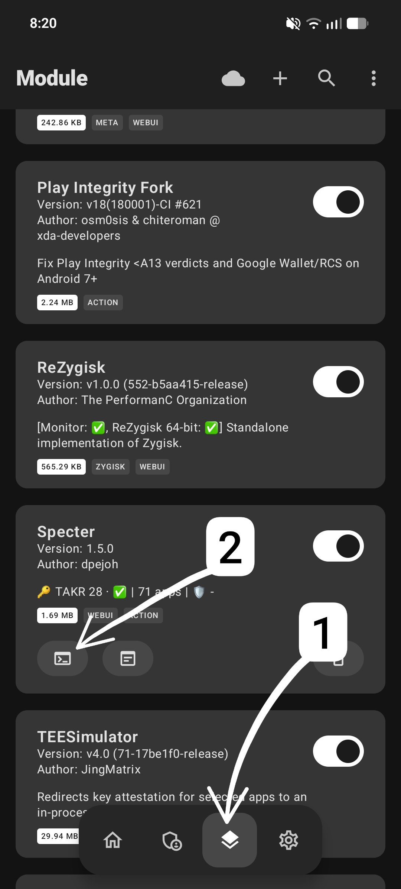
     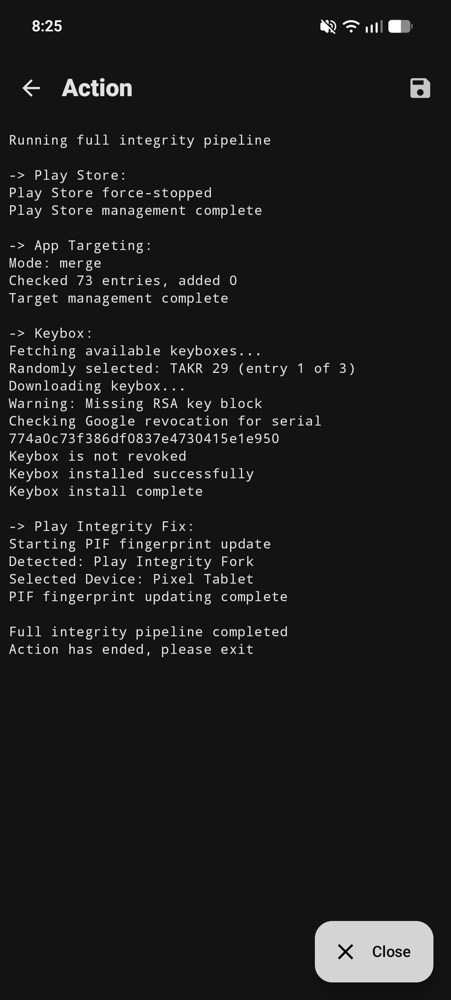
   </details>

3. Открываешь **WebUI** модуля Specter через менеджер и проверяешь, что всё работает.
   <details>
     <summary>Скриншот</summary>
     <br>
     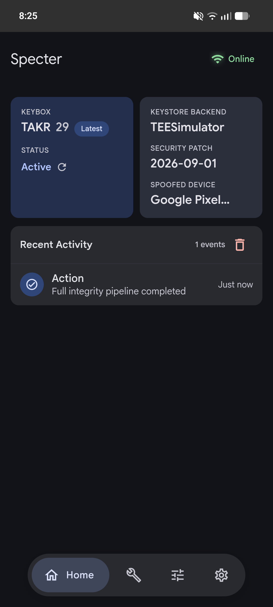
   </details>

4. В том же WebUI выставляешь автоапдейты всего и вся (keybox, периодическое обновление pif, автотаргетинг).
   <details>
     <summary>Скриншот</summary>
     <br>
     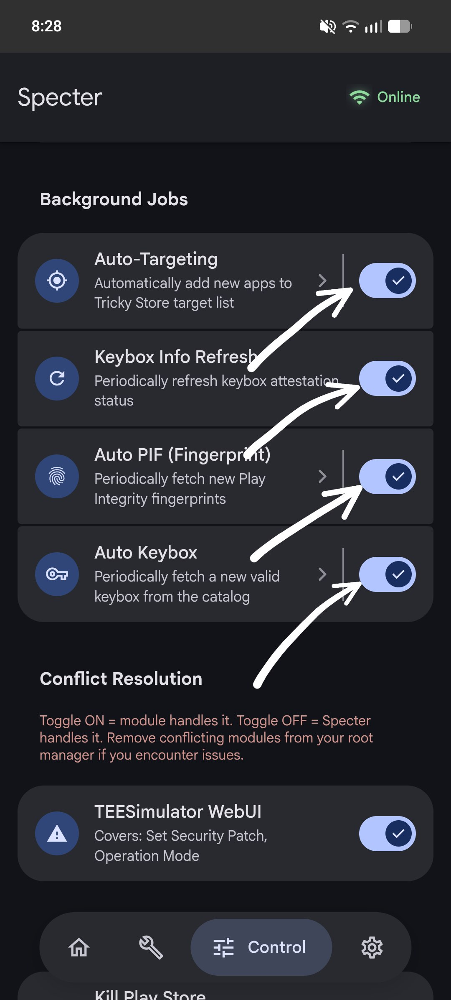
   </details>

5. На соседней вкладке устанавливаешь конфиг для HMA-OSS.
   <details>
     <summary>Скриншот</summary>
     <br>
     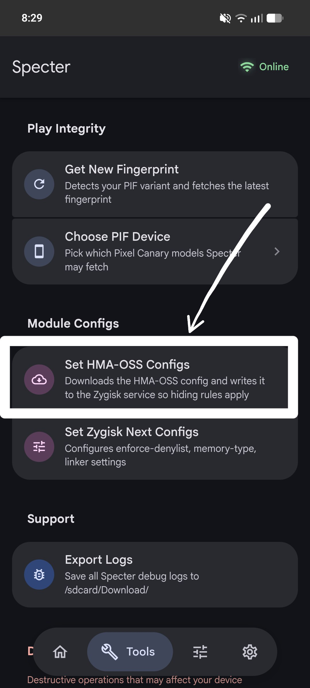
   </details>

6. Проверяешь, чтобы сервис HMA был активен.
   <details>
     <summary>Скриншот</summary>
     <br>
     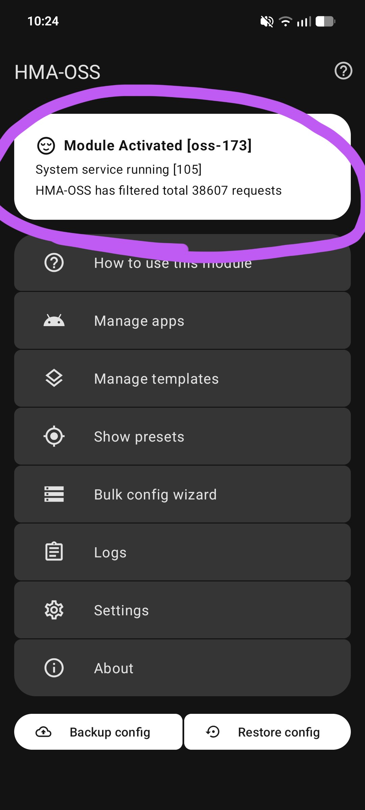
   </details>

После применения конфигов и обязательной перезагрузки получаем полностью скрытый рут:
   <details>
     <summary>Скриншоты результата</summary>
     <br>
  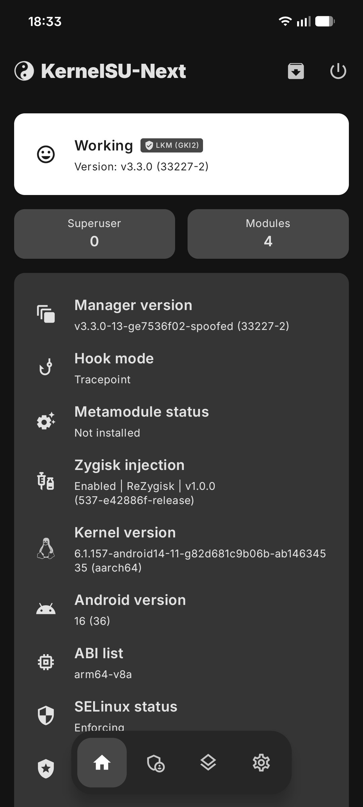
  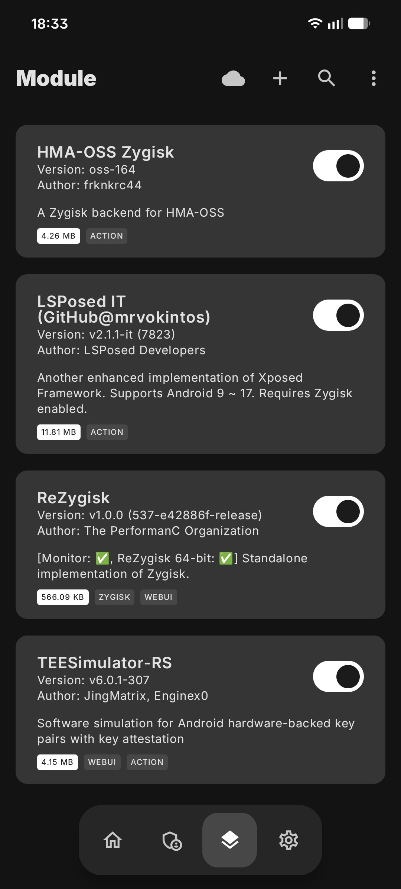
  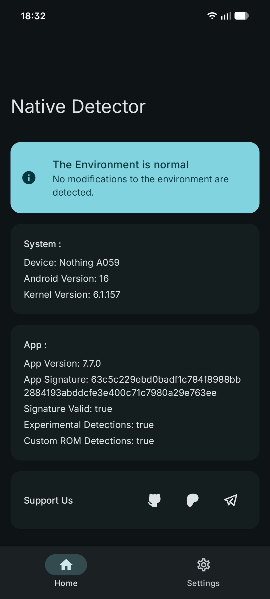
  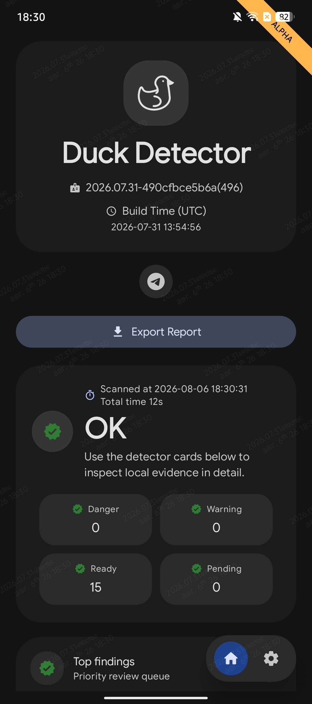
  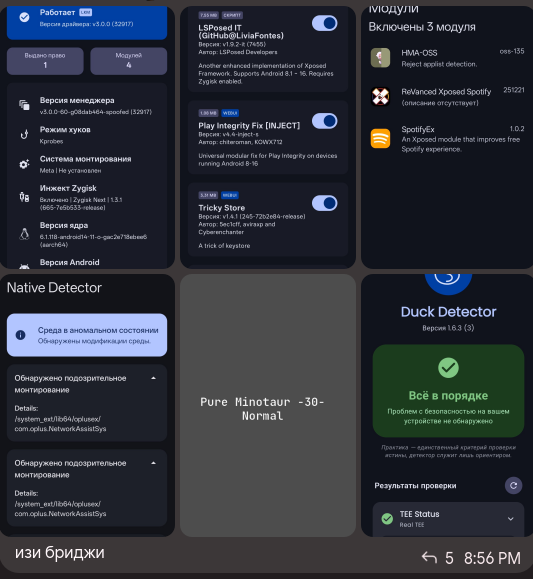
   </details>

---
# 5. Конец

Благодарю за прочтение этого гайда. Я надеюсь, для кого-то он окажется полезным и поможет не попасть на бабки
   <details>
     <summary>Скриншот</summary>
     <br>
     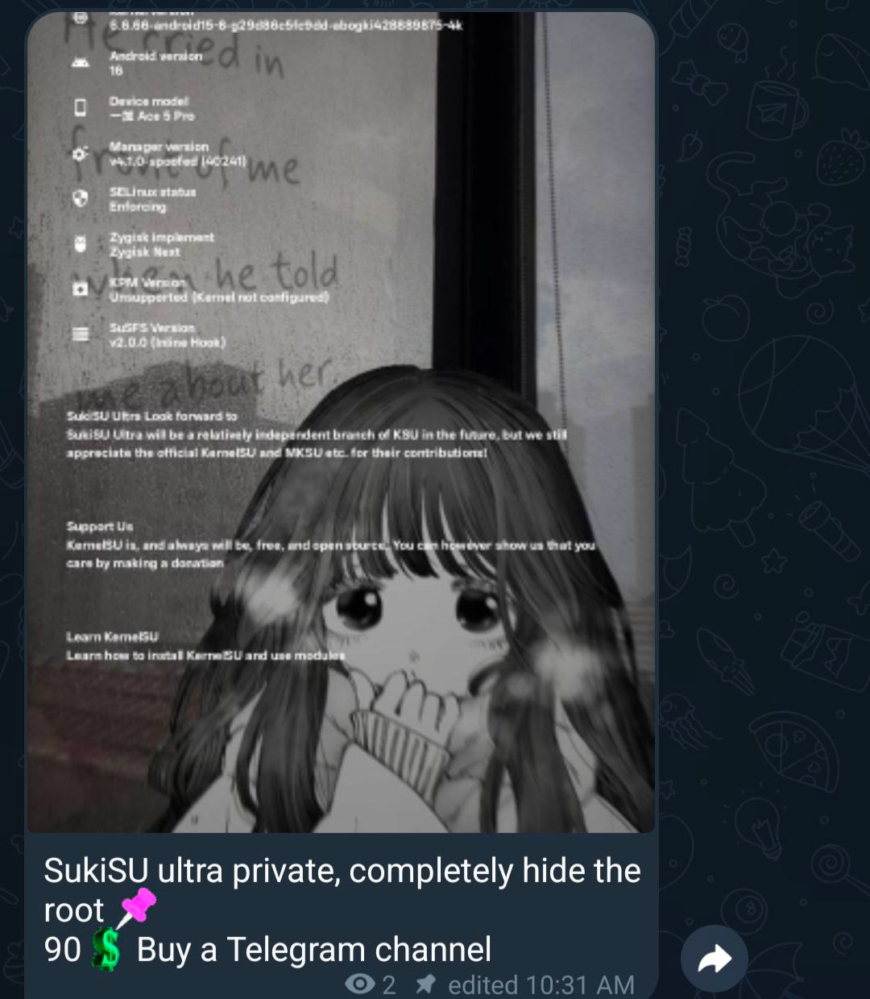
   </details>
<br>

Поддержать авторов гайда, задать вопрос и получить помощь: в телеграме [mrvokintos](https://t.me/mrvokintos) или [fe3rcode](https://t.me/fe3rcode); discord: `mrvokintos`

Оригинальный [гайд](https://github.com/imfe3rcode/RootHide/tree/ac2c640a4e401c62711969cd0afcc4cf7033fa34) by [fe3rcode](https://t.me/fe3rcode)

**Очень прошу тебя не спрашивать очевидные вещи, которые может помочь решить гугл/яндекс/любая нейронка.** **Перед тем, как задавать вопрос, пожалуйста, хотя бы постарайся найти ответ в интернете. Я могу быть агрессивным, когда мне задают очевидные вопросы.**
